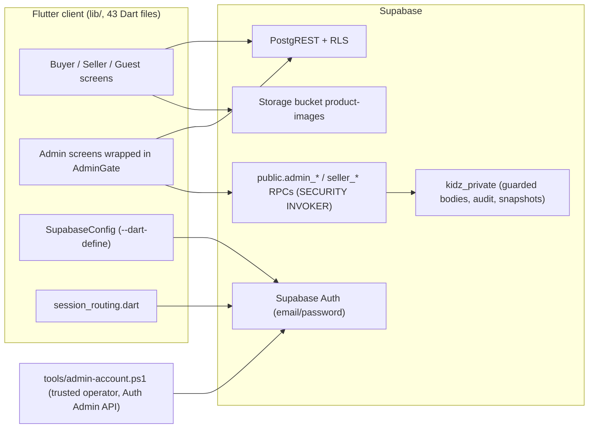

# Kidz Store: Current State as of 6 November 2026

> **Scope.** This document describes the implementation verified on
> **2026-11-06**. It is kept separate from the historical plans on purpose.
> Hosted Seller deployment addendum: **2026-11-07 (+08:00)**, see §8.
> Nothing here is a July 2026 or March 2025 decision. For history, see
> [docs/README.md](README.md).

| Item | Value |
| --- | --- |
| Branch | `main`, integrated from `integration/kidz-latest-20261106`; merge provenance is retained in Git history |
| Application baseline commit | `78efb02` "Restore complete Kidz Flutter app with secure Admin management", 2026-11-06 15:14 +08:00 |
| Application baseline parent | `1fe679e` (GitHub `main`, Version 4, 2025-03-11) |
| Relation to local work | Source-snapshot import of the local `kidz_store` history (`5ead0d7`…`42c5181`, July 2026) plus the uncommitted Admin Phase 1/2 working tree. Compared with the local working tree (line endings ignored), the only differences are publication hygiene: extra `.gitignore` rules, the machine-specific JDK path removed from `android/gradle.properties`, and a local path replaced by `<project>` in two verification records |

---

## 1. Architecture

| Layer | Implementation |
| --- | --- |
| Client | Flutter/Dart (`sdk ^3.6.1`), `supabase_flutter ^2.10.3`, `provider`, `lottie`, `fl_chart`, `image_picker`, `intl`, `uuid`, `shared_preferences`. Imperative `Navigator` routing from `MaterialApp(home: SplashScreen)` |
| Configuration | `lib/supabase_config.dart` reads `SUPABASE_URL` and `SUPABASE_PUBLISHABLE_KEY` at build time. If either is missing, `MissingConfigApp` names the missing key and never shows a value. No credential is committed |
| Backend schema | Four applied migrations: `20260727000000_kidz_initial_schema.sql` (July 2026), `20261106030934_admin_read_access.sql` and `20261106034711_admin_management.sql` (November 2026); Seller migration `20261106094017_seller_order_access.sql` applied/verified on 2026-11-07 (+08:00), see §8 |
| Tests | `test/` (10 test files plus one support file), `supabase/tests/` (4 pgTAP files), `tools/admin-db/` (portable PGlite and full-stack harnesses), `tools/admin-account.Tests.ps1` (Pester) |
| Operator tooling | `tools/admin-account.ps1`: create, inspect, assign-role and reset-password for a dedicated Admin. Masked prompts. Refuses publishable keys. Pinned to one project |

## 2. Supabase Auth

- Every role logs in through Supabase Auth email/password (`lib/login.dart`). The
  legacy plaintext `admin` table lookup has been removed.
- Sign-up calls `auth.signUp`. The `on_auth_user_created` trigger
  (`handle_new_user`) creates the profile row, and the client then `upsert`s the
  profile fields (`lib/signup.dart`).
- **Admin role:** only the exact server-controlled claim `app_metadata.role =
  "admin"` grants access (`lib/admin_access.dart:7`). Sign-up metadata,
  `user_metadata` and profile fields cannot assign it. Admins are provisioned
  with the operator tool, not from the app.
- **Session restoration** (`lib/session_routing.dart`): Buyers and Sellers are
  restored from the persisted session, including offline. An Admin candidate is
  admitted only after online `getUser` verification with a confirmed email and
  a matching identity. Otherwise the user goes to login.
- `AdminGate` wraps every Admin screen. It checks again on Auth events, at token
  expiry and when the app resumes, before any protected query runs.
- **Self-service account deletion is disabled** (`lib/account.dart:142`). It
  shows an informational dialog. The Edge-Function design in `SUPABASE.md` is
  **not deployed**.

## 3. Row-Level Security

RLS is enabled on every application table.

| Table / object | Policies (summary) | Source |
| --- | --- | --- |
| `users` | Owner read/insert/update/delete. **Admin read** (live check) | initial schema; Phase 1/2 |
| `sellers` | Owner read/register/update/delete. **Admin read** | initial schema; Phase 1/2 |
| `products` | **Public read** (guest browsing). Seller inserts/updates/deletes own (`is_own_seller`) | initial schema |
| `cart` | Owner only | initial schema |
| `orders` | Owner read/create/update/delete. **Admin read**. `user_id` is nullable with `ON DELETE SET NULL`, so history is kept after account deletion and is visible only to Admins | initial schema; Phase 1/2 |
| `bankingcard` | Owner only. Synthetic-use restriction is documented, not enforced by RLS; CVV issue remains open | initial schema |
| `admin` (legacy) | RLS on, **no policies**: unreachable | initial schema |
| `kidz_private.admin_audit` | No client access | Phase 2 |
| `kidz_private.seller_order_snapshots` | RLS on, no client table access; private server routines only | Seller fix, E29 |
| Storage `product-images` | Public read. Upload only by registered Sellers under `products/`. No client update/delete | initial schema |

There are no broad Admin INSERT/UPDATE/DELETE policies. Admin writes go only
through RPCs. The live check `kidz_private.is_admin()` requires all of the
following: the exact JWT role, an unexpired token, a matching `auth.sessions`
row, and a confirmed, non-banned user whose current `app_metadata` role is
Admin. Role demotion and logout therefore take effect at the database even for
an already-issued token (E19).

## 4. Restored Admin permissions

These are the historically evidenced Admin operations, restored in Phase 2
(details in [ADMIN_PHASE2.md](../ADMIN_PHASE2.md)):

| Screen | Permission | Mechanism |
| --- | --- | --- |
| Dashboard | Exact counts of profiles, Sellers, products and orders. Chart. Navigation. Logout | Guarded reads; HEAD/count queries |
| Manage Users | View all profiles. **Delete an account** (Auth identity plus cascaded profile, cards, Seller row, products and cart; orders kept) after an impact preview and typing `DELETE`. Admin accounts cannot be deleted | `admin_preview_delete`, `admin_delete_record` |
| Manage Sellers | View all Seller registrations (no mutations, as originally) | Admin read policy |
| Manage Products | View all. **Delete a product** (cart rows cascade; order snapshots and image objects kept) | `admin_preview_delete`, `admin_delete_record` |
| Manage Orders | View all. **Set status** to Packaging, Shipping or Delivering, with stale-edit protection | `admin_set_order_status` |

Each mutation is written to the private audit table in the same transaction.
These were not added, because they never existed in the original: Admin
create-user, profile editing, product creation or editing, Seller approval,
refunds and a role editor.

## 5. Android

| Aspect | State | Evidence |
| --- | --- | --- |
| Application id / label | `com.example.kidz_store`, label "Kidz", adaptive launcher icon | `android/app/build.gradle.kts`; `AndroidManifest.xml`; `4c4b82b`, `077eca7` |
| Network permission | `INTERNET` declared in the main manifest. Without it, release builds failed on every Supabase call | `b4494f9` |
| July 2026 emulator validation | Fixes found on the emulator: rating type crash, sign-up keyboard overflow, session restoration, "null null" display name, unsafe account deletion | `b4494f9`, `42c5181` |
| 2026-11-06 debug APK build | `assembleDebug` **PASS** using synthetic configuration (a compile check only) | `ADMIN_PHASE2_VERIFICATION.md` |
| 2026-11-06 emulator session | Debug APK built, installed and launched on an Android emulator with the local (git-ignored) configuration. The app logged a successful Supabase initialisation and connection | Operator terminal log (E23), reported by the documentation author; not independently reverified here |
| Release signing / distribution | The `release` build type uses the **debug** signing config. No store distribution was found | `android/app/build.gradle.kts:37` |

**Not verified by any recorded evidence:** a full manual run of the Buyer,
Seller and Admin flows on Android against the hosted backend after the
2026-11-06 migration (U-09). The emulator log shows only startup, connection
and sign-out events.

## 6. Verification status (2026-11-06)

| Check | Result | Source |
| --- | --- | --- |
| Flutter test suite on `78efb02` (separate clone) | **PASS: 137 tests** | E24 (re-run during this documentation task) |
| Full isolated Supabase pgTAP | PASS: 94 assertions in 3 files | `ADMIN_PHASE2_VERIFICATION.md` (reported) |
| Full isolated Auth/REST/Storage checks | PASS: 34 | as above (reported) |
| Portable in-memory Postgres scenarios | PASS: 29 | as above (reported) |
| Operator tool tests | PASS: 14 | as above (reported) |
| Web and Android debug builds | PASS (synthetic configuration) | as above (reported) |
| `flutter analyze` (whole project) | NOT CLEAN: 0 errors, 17 warnings, 92 infos (existing code) | as above (reported) |
| Hosted migration | Local operator records show that a verified backup (`backup_verified: true`) and an isolated restore rehearsal (`restore: PASS`, 48 tables matched) were completed. Both Admin migrations were then pushed (`dryRun: false`, "Finished supabase db push") | E22 (outside the repository) |
| Hosted post-migration verification | **VERIFIED read-only:** all three migration versions, current order RLS, live Admin guard definition and Admin role presence. Private original rollout records were not reopened; no hosted management mutation was tested | E26; U-08 limits the historical record only |
| Dedicated hosted Admin account | **VERIFIED role presence:** one current Auth account has server-controlled `app_metadata.role = "admin"` (aggregate query only). The earlier operator-run detail is reported by the documentation author; identities and passwords are omitted | E26; E23 is not independently reopened |

### Hosted status and historical implementation records

Read-only migration history now confirms these applied versions (E26):

- `20260727000000_kidz_initial_schema.sql`
- `20261106030934_admin_read_access.sql`
- `20261106034711_admin_management.sql`

The two Admin migrations were deployed on 2026-11-06 after backup/restore
verification (E22). The current guide `SUPABASE.md` reflects that deployment.
`ADMIN_PHASES.md`, `ADMIN_PHASE2.md` and the two verification reports retain
their original local-stage records, with dated notices explaining the later
hosted deployment. Their statements that no hosted changes were made describe
those earlier implementation tasks, not the current backend. Do not reset or
reapply the already-recorded migrations.

### Seller order visibility: CONFIRMED BUG

**Historical finding from the pre-fix hosted baseline. The fix was subsequently
applied and verified on 2026-11-07 (+08:00), as recorded in §8.**
Hosted catalog inspection (E26) shows Buyer-owner SELECT/UPDATE predicates plus
an Admin SELECT policy, with no Seller order policy. `seller_dashboard.dart`
queries orders before filtering their product IDs; `report_page.dart` delegates
date-range and Top-10 queries to `report.dart`. Client filtering cannot retrieve
rows already excluded by RLS.

The independent isolated reproduction (E27) loads the existing bootstrap and all
three migration files unchanged. Its synthetic Buyer places an order containing
a synthetic Seller's product. The Buyer sees one order; the product-owning Seller
sees zero order rows and zero report rows, and its attempted status UPDATE
returns zero affected rows. An unrelated Seller remains isolated and a verified
Admin sees the unchanged order. These are local database results, not destructive
hosted tests or a new manual UI-session claim.

Impact: the Seller order section omits customer purchases, status handling is
ineffective, and daily/monthly/yearly and Top-10 sales results are empty or
understated. This mismatch exists in the July owner-only schema and is preserved
by the November Admin migrations. The original 2025 backend RLS is unavailable,
so previous live behavior cannot be proven. No application or hosted RLS change
was made during that documentation investigation. The subsequent local fix below
preserves Buyer isolation and scopes Seller access to its own purchase snapshots.

## 7. Known limitations carried forward

- CVV and full card numbers are still collected and stored (`lib/addcard.dart`).
  Documentation permits synthetic values only; owner-only RLS does not enforce
  synthetic data or make storage of real card credentials safe.
- Independent mixed-Seller fulfillment is not implemented: the shared order
  status remains Admin-managed. The former Seller visibility/report regression
  (E26, E27) is fixed and its hosted migration verified; see §8.
- Self-service account deletion is disabled until a server-side function exists.
- No payment gateway, reviews, recommendations, central router, typed models,
  `ThemeData`, persisted Wishlist or Notifications.
- Unguarded `order_items[0]` (`lib/orders.dart:126`). The "Sample Product" cart
  seed. Dead and duplicate files. `print()` diagnostics.
- The historical key is a legacy public `anon` key, not a service-role secret
  (E28). It belongs to a different project whose hostname does not resolve and
  which is absent from accessible projects. No historical key was used in a
  request. Deletion/revocation remain unverified (U-07); no active privileged
  credential was identified. See [Supabase API key types](https://supabase.com/docs/guides/getting-started/api-keys).

## 8. Seller fix and verified hosted integration

The local fix in commit `9551541` (E29) was deployed after separate authorization
on **2026-11-07 (+08:00; 2026-11-06 UTC)** (E30). All four migration versions are
now recorded, including `20261106094017_seller_order_access.sql`. No existing
migration or fulfillment status column changed.

- `seller_order_page` returns only the registered caller's whitelisted item
  snapshots. Customer identifiers/addresses/payment data, unrelated Seller items
  and whole-order totals are excluded. Keyset paging avoids capped report totals.
- A private server-captured ledger preserves ownership and purchase prices across
  later product edits/deletion, including reused product/Seller IDs. Legacy
  ownership missing from the surviving catalogue cannot be guessed or restored
  automatically; review coverage before using historical totals.
- `seller_set_order_status` supports Packaging/Shipping/Delivering only when all
  items belong to the caller, with stale/source-change protection. Mixed or
  unattributed orders remain Admin-managed. Independent per-Seller mixed-order
  fulfillment is **not implemented**; it needs a separate model decision.
- Daily/monthly/yearly and Top-10 reports use purchase cents and quantities, not
  current catalogue prices. Half-open calendar bounds include fractional seconds.
  Totals remain gross item sales, without inventing shipping/coupon allocations.
  Incomplete price/quantity snapshots cause a visible report error rather than
  fabricated sales. Buyer history and highest Admin permissions are preserved.

| Local fix check | Result |
| --- | --- |
| Full Flutter suite | PASS: 149 tests (12 new) |
| Isolated Seller SQL scenarios | PASS: 20 |
| Existing Admin SQL regression scenarios with all four migrations | PASS: 29 |
| Fresh real Supabase pgTAP | PASS: 116 assertions in 4 files |
| Actual isolated Auth/REST/Storage | PASS: 47 checks, including Seller isolation/status/concurrency |
| Web and Android debug builds | PASS with synthetic configuration |
| Full analysis | NOT CLEAN: 0 errors, 11 existing warnings, 89 informational findings |
| Hosted Seller migration/schema/data | PASS: exact dry run and applied version; schema matched rehearsal, all original table fingerprints unchanged |
| Fresh backup and isolated restore | PASS: 49 tables plus schema/RLS/roles/functions/constraints; 3 Storage objects, 85,521 bytes, matching hashes |
| Hosted authorization (read-only DB contexts) | PASS: 3 Sellers; 5 non-Admin accounts' Buyer isolation; Guest denied; Admin session guard and RPC permissions preserved |
| Hosted HTTP boundary | PASS: public catalogue, guest order/RPC denial, private schema not exposed |
| Restored hosted-schema mutation regression | PASS: 22 synthetic Seller/Buyer/Admin assertions; fixture transaction rolled back in isolated copy |
| Fresh hosted authenticated UI login/status mutation | NOT PERFORMED: no account credentials requested, existing hosted records not mutated; Admin currently has no active session |

The before/after counts remain **6 Auth accounts, 6 profiles, 3 Sellers, 4
products, 2 orders and 1 cart**. Both existing order lines were fully attributed
with valid purchase prices and quantities. Passwords, application roles and
account/product/order records have matching pre-deployment fingerprints.

See [SUPABASE.md](../SUPABASE.md#seller-fix-20261106094017_seller_order_accesssql)
for the completed rollout procedure. Backups and private verification manifests
remain outside Git. No hosted business mutation tests or application deployment
were performed; the original project and global development settings are unchanged.
